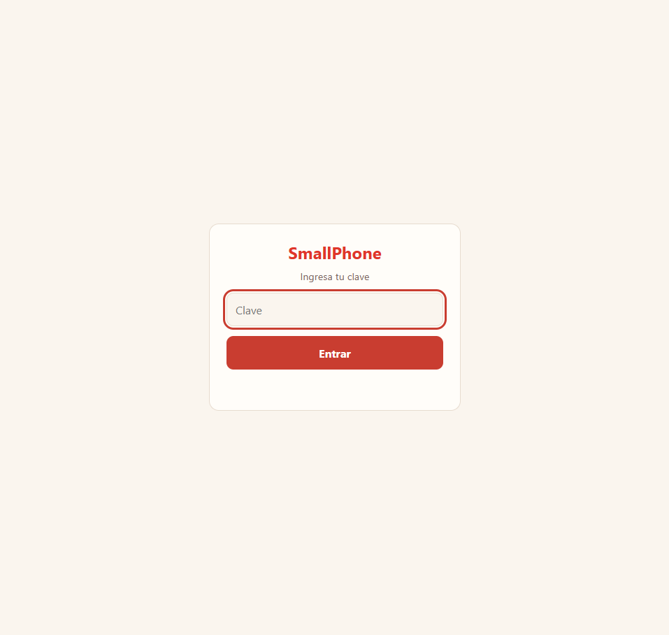
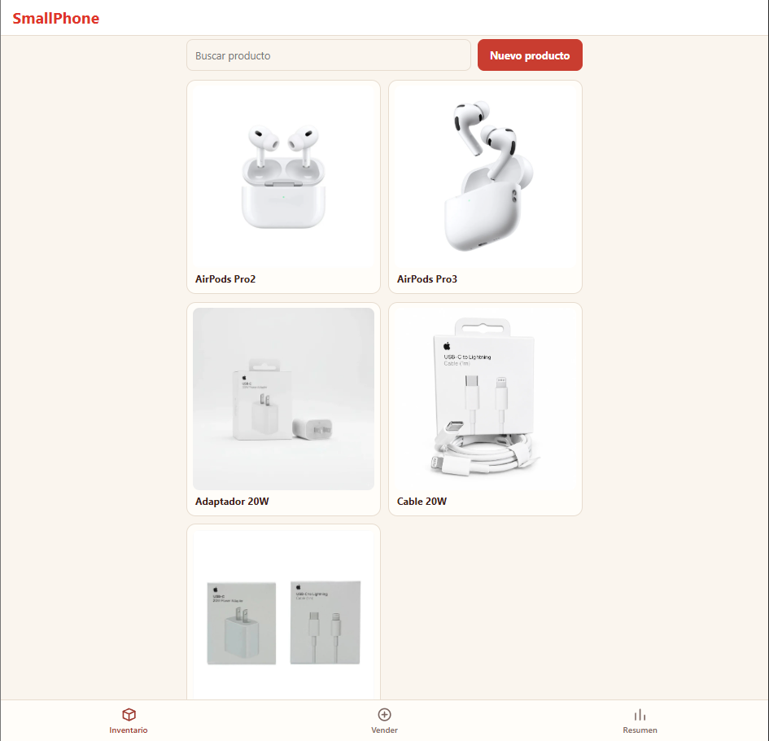
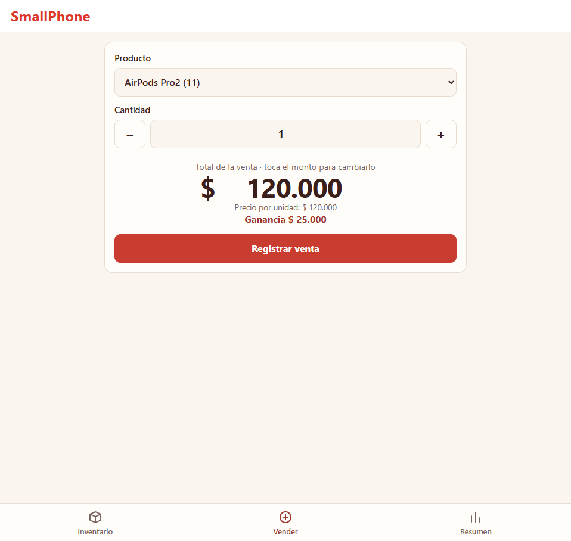
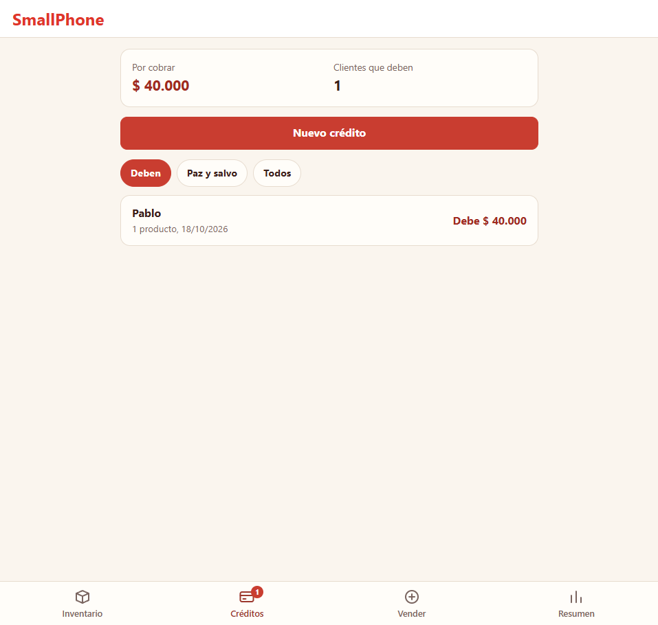
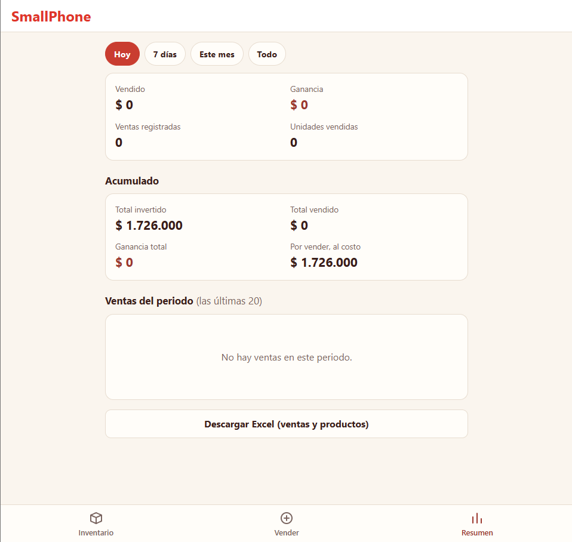

# SmallPhone · Sistema de inventario

Aplicación web para controlar el inventario, las ventas, los créditos y las ganancias de un negocio de accesorios tecnológicos (cables, audífonos, adaptadores, power banks). Está pensada para usarse desde el celular, en el mostrador, con una interfaz simple. Se usa con clientes reales.

Proyecto integrador de Python: **Flask + SQLite + programación orientada a objetos**.

## Capturas

<p align="center">
  
  
  
  
  
</p>
## Qué hace

- **Vender:** registra una venta eligiendo producto y cantidad. El total se puede cambiar para vender a un precio distinto al de lista, y la ganancia se recalcula al instante.
- **Inventario:** tarjetas con foto y nombre; al tocar una se ve el detalle (costo, precio, unidades compradas y vendidas, totales, ganancia y precio promedio vendido). Permite crear, editar, reponer stock, corregir unidades y eliminar. Un botón con forma de ojo oculta los precios con asteriscos para enseñar la app sin mostrar los números.
- **Créditos:** control de clientes que pagan en partes. Un crédito puede incluir varios productos, un abono inicial y una fecha del próximo pago. Cada cliente aparece en una tarjeta con lo que debe; los vencidos se marcan en rojo y los que están a paz y salvo en verde. Se registran abonos y se puede anular el crédito completo (las unidades vuelven al stock).
- **Resumen:** ventas, ganancia y unidades por periodo (hoy, 7 días, mes, todo), acumulado del negocio, lo cobrado de verdad (contado + abonos), lo que falta por cobrar y la lista de ventas con opción de anularlas.
- **Excel:** descarga de todas las ventas y productos en un `.xlsx`.
- **Respaldo automático:** una copia diaria de la base de datos en `respaldos/` (se conservan las últimas 14).
- **Login opcional:** si se define la variable de entorno `SMALL_PASSWORD`, la app pide clave (sesión de 30 días). Sin ella, funciona abierta en el PC.

## Decisiones de diseño

- **Tres capas separadas:** `models.py` (reglas del negocio, sin saber de Flask ni SQL), `database.py` (todo el SQL) y `app.py` (rutas HTTP).
- **Cada venta guarda su propio precio y costo** del momento, así vender a precios distintos o cambiar el precio de lista no altera el historial.
- **Costo promedio al reponer:** si repones con un costo distinto, el costo del producto pasa a ser el promedio de todo lo comprado.
- **Operaciones atómicas:** registrar o anular una venta, un crédito o un abono actualiza todo en una sola transacción; si algo falla, no queda nada a medias y se deshace el cambio en memoria.
- **Un crédito se anula completo**, no venta por venta, para que el stock y los abonos nunca queden descuadrados.
- **Vendido vs. cobrado:** una venta a crédito cuenta como vendida el día que se hace, pero como cobrada solo cuando entran los abonos.
- **Los ID de productos con ventas no se reutilizan**, para no mezclar historiales.
- **Validación en el modelo:** las clases rechazan datos inválidos (negativos, textos donde va un número, stock insuficiente) y la API responde con un mensaje claro.

## Tecnologías

Python 3 · Flask · SQLite (`sqlite3`) · openpyxl · HTML, CSS y JavaScript sin frameworks.

## Estructura

```
SMALL_app/
├── app.py            # rutas de la API, login y arranque
├── models.py         # clases Producto, Venta, Abono, Credito e Inventario
├── database.py       # acceso a SQLite, migraciones y respaldos
├── static/
│   ├── index.html    # la página (se usa desde el celular)
│   └── fotos/        # fotos de productos (no se sube a Git)
├── requirements.txt
└── iniciar.bat       # arranque rápido en Windows
```

## Cómo ejecutarlo (Windows)

```powershell
git clone https://github.com/RodoCap/SMALL_app
cd SMALL_app
python -m venv venv
.\venv\Scripts\Activate.ps1
pip install -r requirements.txt
python app.py
```

Al arrancar muestra dos direcciones: una para el PC (`http://127.0.0.1:5000`) y otra para el celular, que debe estar en el mismo WiFi. La base de datos (`inventario.db`) se crea sola la primera vez.

## Publicarlo en internet

La app corre en PythonAnywhere (plan gratuito) para usarla desde el celular sin tener el PC encendido. Allí se definen dos variables de entorno en el archivo WSGI: `SMALL_PASSWORD` (la clave de entrada) y `SECRET_KEY` (para firmar la sesión). Nunca se suben a Git.

## API

| Método | Ruta | Qué hace |
|---|---|---|
| GET | `/productos` | Lista los productos con sus totales |
| POST | `/productos` | Crea un producto |
| PUT | `/productos/<id>` | Edita datos (y corrige unidades compradas) |
| DELETE | `/productos/<id>` | Elimina un producto (las ventas se conservan) |
| POST | `/productos/<id>/reponer` | Repone stock, con costo opcional |
| POST | `/productos/<id>/foto` | Sube la foto del producto (JPG) |
| GET | `/ventas` | Lista las ventas |
| POST | `/ventas` | Registra una venta (precio opcional) |
| DELETE | `/ventas/<id>` | Anula una venta y devuelve el stock |
| GET | `/creditos` | Lista los créditos con productos, abonos y saldo |
| POST | `/creditos` | Crea un crédito (varios productos, abono inicial y fecha opcionales) |
| POST | `/creditos/<id>/abonos` | Registra un abono |
| DELETE | `/creditos/<id>` | Anula el crédito completo y devuelve el stock |
| GET | `/resumen` | Totales generales |
| GET | `/exportar` | Descarga el Excel |

## Autor

Rodo · [github.com/RodoCap](https://github.com/RodoCap)